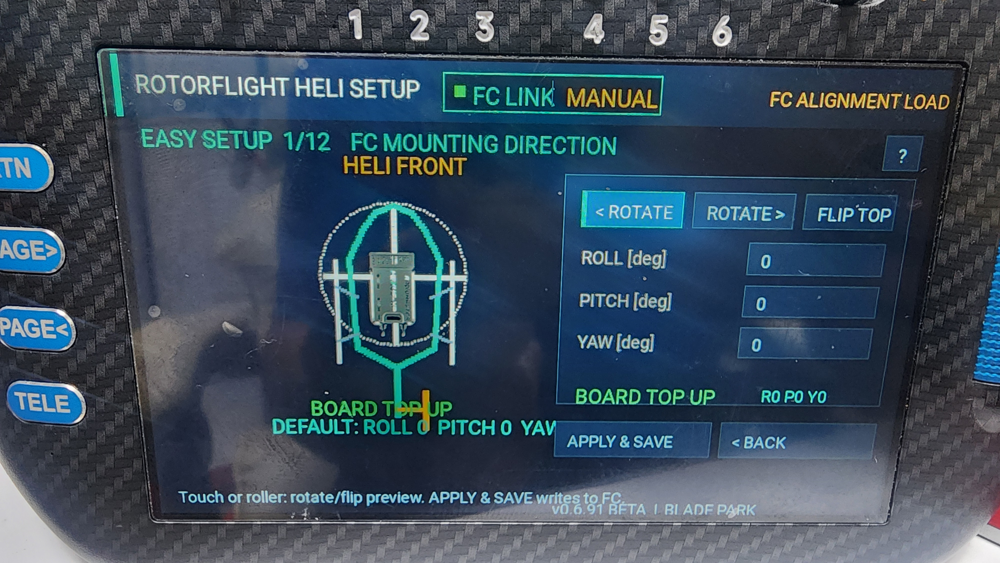
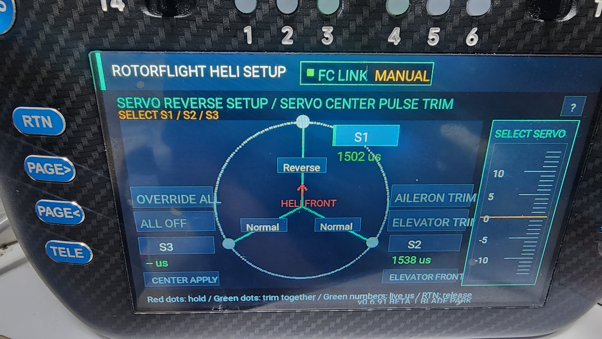
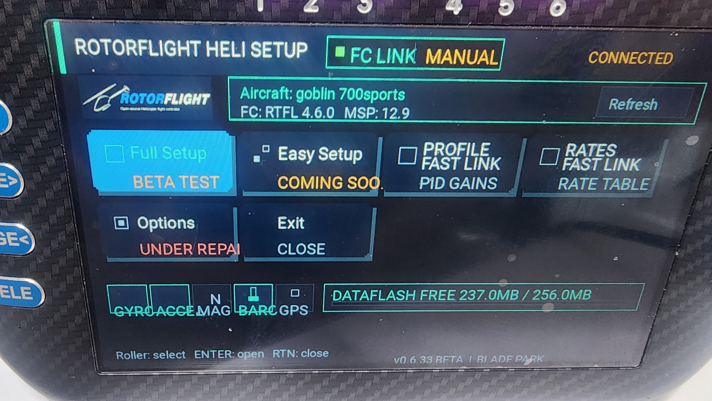
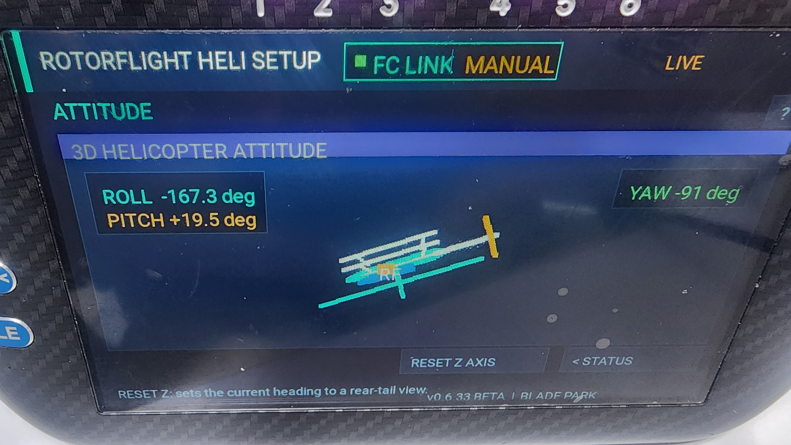
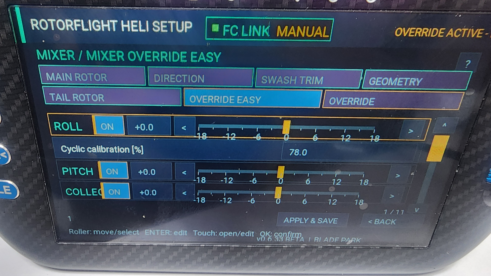
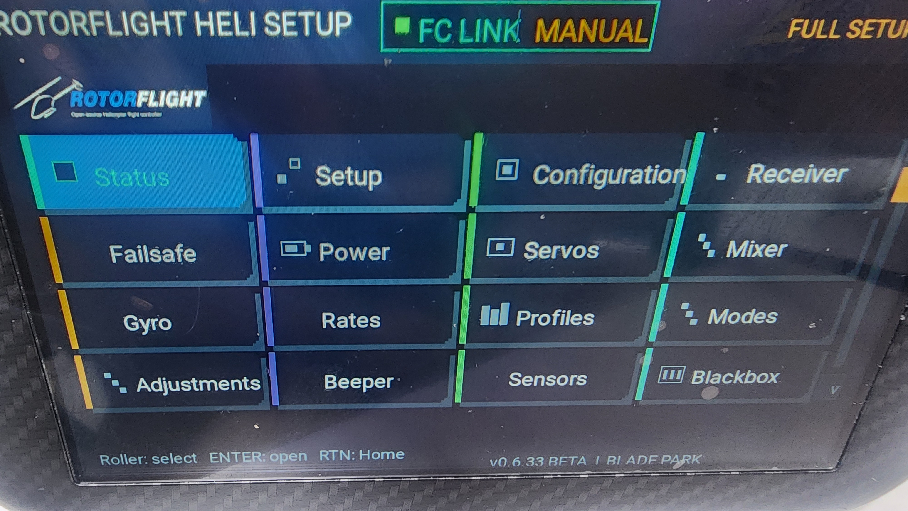

# RFLUASETUP

> **2026-11-04: Latest release / 최신 버전: 0.7.125 BETA.** Improved 3D helicopter model and faster graphics / 3D 헬기 모델 개선 및 화면 속도 개선.
>
> [Download 0.7.125 BETA](release/RFLUASETUP-0.7.125-FAST-SETUP-GRAPHICS.zip) · [변경 내용 / Notes](RELEASE-0.7.125.md) · [전체 저장 경로 감사 / Audit](docs/SAVE-PATH-AUDIT-2026-10-25.md)
>
> **Updated / 업데이트: 2026-11-04 (KST)**

[English](#english) · [한국어](#한국어)

## English

RFLUASETUP is an EdgeTX transmitter Lua interface developed from the menus and configuration workflow of Rotorflight Configurator 2.3.0. The goal is to make as much of the Configurator as practical available directly from the transmitter.

Current version: **0.7.125 BETA — updated November 4, 2026 (KST)**. Improved solid 3D helicopter model, faster graphics, dedicated attitude/receiver updates and optimized Easy Setup drawings. Earlier center-save verification and catalogue data are retained. **Nine separate Full Setup audit findings remain unresolved; validation is incomplete.**

[Download 0.7.125 BETA](https://github.com/parksp/RFLUASETUP/releases/download/v0.7.125-beta/RFLUASETUP-0.7.125-FAST-SETUP-GRAPHICS.zip) · [Bilingual release notes](RELEASE-0.7.125.md)

### 3D model and speed improvements

- A solid 3D helicopter with native drawing and reusable coordinates.
- RESET Z selects the straight rear hovering view.
- Dedicated Receiver channel updates and optimized Easy Setup graphics.
- The user confirmed noticeably faster operation on the transmitter.

### Motors: aircraft gearing and motor pole catalogue

- Select a helicopter manufacturer and model in Motors to look up its main/tail gear ratios and confirmed pinion/pulley options. The catalogue contains **20 brands / 586 model-version entries**, with **478 manufacturer-documented, 3 dealer references and 105 manual entries** clearly distinguished.
- Select a motor manufacturer, model and KV from the **16-brand motor catalogue** to fill the motor pole-count field where a supported pole count is available. Pole counts are model-specific; unknown or conflicting specifications are not presented as confirmed values.
- Catalogue selection/APPLY and **SAVE FC** are separate actions. Battery/governor RPM estimates are references for manually choosing PROFILE 1/2/3 target RPM.

### Easy Setup progress

Easy Setup is nearing completion and has received further updates. Users already familiar with Rotorflight should be able to get close to their intended helicopter setup through the current Easy Setup workflow.

- Main Rotor Geometry: independent axis overrides, calibration and swash trim. RETURN restores unsaved values.
- Motor + Gear Ratio Input: Easy Setup step 5 opens the shared Full Setup Motors menu.
- Tail Setup: servo/motor tail defaults and rotor settings, single-press override ON/OFF and a horizontal slider. RETURN → DISCARD restores unsaved live edits.

- Swash servo defaults: 1520/760 pulse presets, Rate/Speed, per-servo Reverse, Limits/Scale/Geo, with an overwrite warning and confirmation before saving.
- Servo reverse and center-pulse trim: FRONT/REAR choice, measured output pulses and confirmed Center Apply. Saves verify FC values before/after EEPROM and identify persistent mismatches.
- Keep overrides enabled while trimming any green-selected S1/S2/S3 subset; red servos hold their current positions. ALL selection and AILERON/ELEVATOR trim are available.
- Easy Setup is in its final development stage. Final refinements and complete flight validation remain.

Current changes were checked with a simulated FC, Lua event tests, rendered screens and syntax checks. They are not fully validated on physical aircraft/transmitters. Disconnect the motor and remove blades for bench testing; check manufacturer servo specifications and compare settings with the PC Configurator.

**TX16S MK2:** The tool also runs on RadioMaster TX16S MK2. Because the layout is designed for the MK3 display proportions, some menus or parts of the screen may occasionally be clipped on MK2. Full feature validation remains incomplete.

Development is primarily based on NEXUS XR, using RadioMaster TX16S MK3/MK2 with the currently tested EdgeTX environment and Rotorflight 4.6.x firmware. Operation has been confirmed on **NEXUS XR and FlyDragon V2.2**. Some other compatible FCs, including Matek units, have also been partially checked.
### Installation Requirements

- RadioMaster TX16S MK3; TX16S MK2 can also be used, with occasional screen/menu clipping due to display proportions
- The currently tested EdgeTX environment on that transmitter
- Confirmed FCs: **NEXUS XR and FlyDragon V2.2**; NEXUS XR is the primary development platform
- Partially checked: some other compatible FCs, including Matek
- The currently tested Rotorflight 4.6.x firmware
- Rotorflight Configurator 2.3.0 as the comparison reference
- Working receiver telemetry and MSP communication
- Installation path `/SCRIPTS/RFLUASETUP`

Validation across other transmitters, display sizes, FCs, receivers, telemetry protocols and firmware versions remains incomplete. FCs beyond the confirmed NEXUS XR and FlyDragon V2.2 include partially checked models such as Matek. Back up the FC with `dump` or `diff` before installation and close the PC Configurator connection while using the transmitter Lua tool.

See [English installation](INSTALL-EN.txt) and [current bilingual release notes](RELEASE-0.7.125.md). The [0.6.33 English user manual](docs/RFLUASETUP-0.6.33-English-User-Manual.docx) and photographs specifically labeled 0.6.33 describe the older release and may not match current Easy Setup screens. The Easy Setup photos labeled 0.6.91 show an earlier release.

## Main Areas

- Status and live receiver channels
- Setup and Configuration
- Receiver, telemetry sensors, Failsafe and Power
- Motors, RPM gear ratio and motor override
- Governor and bypass curve
- Servos and Mixer
- Gyro, Rates and PID Profiles
- Modes and Adjustments
- Beepers, Sensors and Blackbox

## Collaboration

Bug reports, test results, translations and code improvements are welcome. Read [CONTRIBUTING.md](CONTRIBUTING.md) before submitting an issue or pull request.

## Credits

Created by **BLADE PARK**. This independent Lua project is based on the behavior and public source of Rotorflight Configurator and Rotorflight firmware. Rotorflight names, logos and upstream source remain the property of their respective owners and contributors.

## License

Released under the GNU General Public License v3.0. See [LICENSE](LICENSE).

---

## 한국어

Easy Setup은 이제 거의 마무리 단계이며, 추가 업데이트를 적용했습니다. 기존 Rotorflight 사용자라면 현재 Easy Setup 흐름으로 원하는 기체 설정에 상당히 근접할 수 있을 것으로 기대합니다.

### 모터: 기체별 기어비 및 제조사별 모터 폴수

- MOTOR 항목에서 **헬기 제조사 → 기체 모델**을 선택해 메인·테일 기어비와 확인된 피니언·풀리 옵션을 조회할 수 있습니다. **20개 제조사 / 586개 모델·버전**을 수록했으며, **제조사 문서 478개·판매처 참고 3개·수동 입력 105개**를 구분합니다.
- **모터 제조사 → 모델·KV**를 선택하는 **16개 제조사 모터 카탈로그**를 넣었습니다. 폴수(극수)가 확인된 모델은 선택 시 모터 폴수 입력란에 반영됩니다. 미확인·자료 충돌 항목은 확정값으로 취급하지 않습니다.
- 카탈로그 선택·APPLY와 **SAVE FC는 별도 동작**입니다. 배터리·거버너 RPM 계산은 PROFILE 1/2/3의 목표 RPM을 사용자가 정하기 위한 참고값입니다.

RFLUASETUP은 Rotorflight Configurator 2.3.0의 메뉴 구성과 설정 방식을 분석하여 EdgeTX 조종기용 Lua 인터페이스로 구현한 프로젝트입니다. 가능한 한 많은 Configurator 기능을 PC 없이 조종기에서 확인하고 설정할 수 있도록 만드는 것이 목표입니다.

현재 버전은 **0.7.125 BETA — 2026년 11월 4일(KST) 업데이트**입니다. 3D 헬기 모델과 화면 속도를 개선하고, 자세·Receiver 전용 조회와 Easy Setup 그림 최적화를 적용했습니다. 기존 센터 저장 검증과 카탈로그 자료는 유지합니다. **Full Setup의 별도 감사 문제 9개는 미해결이며 전체 검증은 완료되지 않았습니다.**

[0.7.125 BETA 다운로드 / Download](https://github.com/parksp/RFLUASETUP/raw/refs/heads/main/release/RFLUASETUP-0.7.125-FAST-SETUP-GRAPHICS.zip) · [한글·영문 변경 안내 / Bilingual release notes](RELEASE-0.7.125.md)

### Easy Setup 진행 상황

- Main Rotor Geometry: 축별 오버라이드·캘리브레이션·스와쉬 트림. 저장하지 않고 RETURN하면 원래 값 복원.
- Tail Setup: 서보/모터 테일, 기본값과 로터 설정, 한 번 눌러 ON/OFF, 수평 슬라이더. 미저장값은 RETURN → DISCARD에서 복원.

- 스와쉬 서보 기본값: 1520/760 펄스, Rate/Speed, 개별 Reverse, Limits/Scale/Geo 편집 및 저장 전 경고·확인.
- 서보 리버스·센터 펄스 트림: FRONT/REAR 선택, 기수 방향 표시, 실제 출력 펄스 확인, Center Apply 확인 후 저장.
- 오버라이드를 유지하면서 초록색으로 선택한 S1/S2/S3 조합만 트림. 빨간색 서보는 현재 위치 유지. ALL 선택과 AILERON/ELEVATOR 조정 지원.
- Easy Setup은 마무리 단계이며 최종 다듬기와 전체 기능·비행 검증이 남아 있습니다.

이번 변경은 모의 FC, Lua 이벤트, 화면 렌더와 문법 검사로 확인했습니다. 실제 기체·조종기의 모든 기능을 검증한 것은 아닙니다. 모터 연결과 블레이드를 분리하고, 제조사 서보 사양 및 PC Configurator 값과 대조하여 시험하세요.

**TX16S MK2:** RadioMaster TX16S MK2에서도 사용할 수 있습니다. 다만 MK3 화면 비율을 기준으로 구성되어 있어, MK2에서는 화면 비율 차이로 일부 메뉴나 화면이 간혹 잘려 표시될 수 있습니다. 전체 기능 검증은 아직 완료되지 않았습니다.
## 조종기 실제 화면 / Actual Radio Screens

### Easy Setup — 0.6.91 BETA

사용자가 제공한 이전 0.6.91 BETA 실제 조종기 화면입니다. 사진은 당시 서보 센터 설정까지 구현했던 중간 버전을 보여주며 현재 화면과 다를 수 있습니다. 사진에 표시된 펄스값은 해당 기체의 예시이며 권장 설정값이 아닙니다.

User-provided photographs of 0.6.91 BETA running on a transmitter. Easy Setup remains unfinished, implemented through servo center setup. Pulse values shown belong to the photographed setup; they are not recommended defaults.

| FC 장착 방향 / FC mounting direction | 서보 리버스·센터 펄스 트림 / Servo reverse & center-pulse trim |
|---|---|
|  |  |

사진을 클릭하면 원본 크기로 볼 수 있습니다. / Click a photo to view the original.

### 이전 화면 / Earlier screens — 0.6.33 BETA

아래 사진은 **이전 0.6.33 BETA**를 RadioMaster TX16S MK3에서 실행한 실제 화면입니다. 현재 0.7.125의 Easy Setup 화면과는 다를 수 있습니다.

| 메인 화면 / Main screen | 3D 헬리콥터 자세 / 3D Helicopter Attitude |
|---|---|
|  |  |

| MIXER OVERRIDE EASY | FULL SETUP |
|---|---|
|  |  |
## 설치 조건

주요 개발·시험 기준은 MK3이며, MK2에서도 사용할 수 있습니다. MK2는 화면 비율 차이로 일부 메뉴나 화면이 간혹 잘릴 수 있습니다.

| 항목 | 현재 확인 조건 |
|---|---|
| 조종기 | **RadioMaster TX16S MK3 / TX16S MK2** |
| 조종기 운영체제 | 해당 조종기에서 현재 사용 중인 EdgeTX 환경 |
| FC — 확인 완료 | **NEXUS XR / FlyDragon V2.2** (NEXUS XR 우선 개발 기준) |
| 기타 FC — 부분 확인 | Matek 등 일부 호환 FC에서도 부분 확인 |
| FC 펌웨어 | 현재 사용 중인 Rotorflight 4.6.x 계열 |
| 비교 기준 | Rotorflight Configurator 2.3.0 |
| 화면 | TX16S MK3의 800 × 480 컬러 터치 화면 기준. MK2는 화면 비율 차이로 일부 메뉴·화면이 간혹 잘릴 수 있음 |
| 통신 | 수신기 텔레메트리를 통한 MSP 통신이 정상적으로 구성된 모델 |
| SD 카드 경로 | `/SCRIPTS/RFLUASETUP` |

NEXUS XR을 우선 기준으로 개발했으며, **NEXUS XR과 FlyDragon V2.2는 동작 확인을 완료했습니다.** Matek을 비롯한 그 외 일부 호환 FC에서도 부분적으로 확인했습니다.

다른 EdgeTX 조종기, 화면 크기, FC, 수신기, 텔레메트리 방식과 펌웨어 버전에 대한 전체 검증은 아직 완료되지 않았습니다. 조건이 다르면 화면 배치, MSP 데이터 읽기, 실시간 갱신 또는 저장 기능이 정상적으로 동작하지 않을 수 있습니다.

설치 전에는 PC용 Rotorflight Configurator에서 FC 설정을 `dump` 또는 `diff`로 백업해야 합니다. 조종기 Lua를 사용할 때는 PC Configurator의 FC 연결을 종료하는 것을 권장합니다.

## 검증 범위

- 개발 중인 BETA이며 Easy Setup은 마무리 단계입니다. 보드 정렬·Receiver·서보/스와쉬·Geometry·Tail·모터/기어비 흐름을 포함합니다.
- 장기간 실제 운용이나 다양한 기체 조합의 검증은 아직 진행되지 않았습니다.
- 최신 변경은 모의 FC의 읽기/쓰기, 확인 후 저장, 다중 선택 트림, 오류 처리와 화면 검사로 확인했습니다. 실기 검증은 별도로 필요합니다.
- 우선 개발·시험 기준은 **RadioMaster TX16S MK3의 현재 EdgeTX 환경**과 **NEXUS XR의 현재 Rotorflight 4.6.x 펌웨어** 조합입니다. **TX16S MK2도 사용 가능하며, NEXUS XR·FlyDragon V2.2는 동작 확인 완료**, Matek 등 그 외 일부 FC는 부분 확인했습니다.
- 다른 조종기, 화면 해상도, FC 및 펌웨어에서의 동작은 보장하지 않습니다.

실제 비행에 적용하기 전에 Rotorflight Configurator 2.3.0과 모든 값을 비교하고, 모터와 블레이드를 안전하게 분리한 상태에서 벤치 테스트를 진행하십시오. 사용과 설정 변경의 판단 및 책임은 사용자에게 있습니다.

## 설치

1. 최신 Release ZIP을 내려받습니다.
2. ZIP 안의 `SD-CARD/SCRIPTS` 폴더를 조종기 SD 카드 최상위에 복사합니다.
3. 최종 경로가 `/SCRIPTS/RFLUASETUP/main.lua`인지 확인합니다.
4. 기존 버전이 있다면 폴더 전체를 교체합니다. 서로 다른 버전의 파일을 섞지 마십시오.
5. EdgeTX를 재시작하고 시스템 또는 TOOLS 페이지에서 RFLUASETUP을 실행합니다.
6. 상단의 `FC LINK`와 하단의 `0.7.125 BETA`를 확인합니다.

자세한 내용은 [한국어 설치 안내](설치방법.txt)와 [최신 한글·영문 변경 안내](RELEASE-0.7.125.md)를 참고하십시오. [0.6.33 한국어 사용자 매뉴얼](docs/RFLUASETUP-0.6.33-한국어-사용자-매뉴얼.docx)은 이전 버전 참고용입니다.
